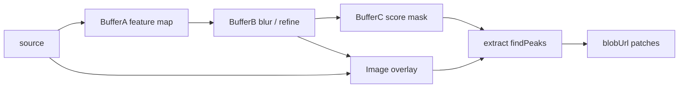

# Shader

`sonic-shader` — renderer WebGL2 **compatible ShaderToy** (pass `Image` + buffers `A–D` + `Common`).

For WGSL / WebGPU (1 pass, same DP glue): [`sonic-webgpu`](#core/components/functional/webgpu/webgpu.md/webgpu).

Import opt-in (hors bundle `functional`) :

<sonic-code language="javascript">
  <template>
import "@supersoniks/creative-stack/shader";
import type {
  SonicShaderConfig,
  SonicShaderOutput,
  ShaderExtractOutput,
  ShaderRoi,
  ShaderMouseMode,
  ShaderHoverParam,
} from "@supersoniks/creative-stack/shader";
  </template>
</sonic-code>

CDN (after the core): `creative-stack-shader.bundle.js` — see [CDN addons](#docs/_getting-started/cdn-addons.md/cdn-addons).

Uniforms supportés : `iResolution`, `iTime`, `iTimeDelta`, `iFrame`, `iFrameRate`, `iMouse`, `iDate`, `iChannel0–3`, `iChannelResolution`, `iChannelTime`, `iSampleRate`, `uParam0–3`.

Textures `channel0–3` : images, vidéos (`.webm` / `.mp4` / …), **ou** éléments page via `#id` (``, `<video>`, `<canvas>`, `sonic-3d` / `sonic-webgpu` / `sonic-shader`).

## Multipass sur une photo

Buffer A simule une height-map d’ondes (ripple) ; Image réfracte la photo via le gradient — **sans teinte**. Glisser la souris pour faire des vagues.

<docs-lit-demo for="docs-shader-multipass-demo"></docs-lit-demo>

Photo + depth parallax (HF): [Visual stack](#docs/_misc/visual-stack.md/visual-stack).

Live 3D → shader (no JPEG): [Visual stack](#docs/_misc/visual-stack.md/visual-stack).

## Chaînage d’effets (officiel)

**Règle :** brancher des passes dans **un** `sonic-shader` (buffers `A–D` → `Image`), pas deux composants via dataProvider — **sauf** pont live `#élément` (copie canvas chaque frame).

| Besoin | Mécanisme |
|--------|-----------|
| Sortie d’un effet → entrée du suivant | `image-ch0="buffer-a"` (ou `buffer-b`… / `self`) — **même contexte GPU**, FBO ping-pong |
| Scene 3D / autre canvas → post | `channel0="#plateau"` — copie `texImage2D` chaque `frameSeq` |
| Params / sync UI | `dataProvider` → `uParam0…3` **et** canaux (`channel0`, `bufferACh0`…) — string URL, `#id`, ou `SonicMediaRef` (`url` / `element`). Changer un canal ne recompile pas (rebind). |
| Hors viewport | `release-offscreen` : `auto` (défaut) libère sauf si une passe lit `self` ; `true` / `false` forcent |

Les passes intermédiaires sont **déjà offscreen** (FBO). Pas besoin d’un second `sonic-shader` invisible pour du multipass interne.

Deux instances séparées ne partagent pas leurs textures WebGL (contextes distincts). Le pont live `#id` **copie** le canvas source ; `frame-out` JPEG reste pour export / freeze.
Démo pédagogique : Buffer&nbsp;A = Sobel → Image = overlay + `param0`.

<docs-lit-demo for="docs-shader-chain-demo"></docs-lit-demo>

Exemple de câblage :

<sonic-code language="html">
  <template>
&lt;sonic-shader
  play
  buffer-a-ch0="/photo.jpg"
  image-ch0="buffer-a"
  image-ch1="/photo.jpg"
&gt;&lt;/sonic-shader&gt;
&lt;!-- .bufferA = effet A ; .image = effet B qui lit iChannel0 = buffer A --&gt;
  </template>
</sonic-code>

## Rollover / roll-out (`hover-param`)

Au survol, le composant anime un `uParamN` de `0` → `1` (et l’inverse au leave), avec easing `hover-speed`. Le shader lit ce param pour mixer l’effet on/off (zoom, aberration, ripple…). `play-on-hover` n’anime que pendant le hover / la transition.

Type : `ShaderHoverParam` = `0` | `1` | `2` | `3` | `"param0"`…`"param3"` | `""`.

<docs-lit-demo for="docs-shader-hover-demo"></docs-lit-demo>

## Sortie / sampling (`sample` + dataProvider)

`dataProvider` est **bidirectionnel** : `param0…` en entrée ; en sortie `mouseX` / `mouseY` / `hovering` / `frame` (+ `param0…` si `out-data-provider` est séparé, ou le slot `hover-param` seul si le DP est partagé avec le formulaire). Avec `sample`, lit la couleur sous le curseur → `sampleR/G/B/A` + `sampleLuma` (`SonicShaderOutput`). Event `out` (payload complet, y compris les params). Optionnel : `out-data-provider` pour séparer l’écriture.

**Publication paresseuse** : rien n’est écrit (ni `readPixels`) tant qu’aucun champ méta/sample n’a de lecteur DP (`@handle(frame)` / `@subscribe` / `sonic-value`…) et qu’aucun listener `out` n’est branché. Un `sonic-input name="param0"` ne compte **pas** comme consommateur out (évite le write-back qui remettait les champs à 0). Dès qu’un vrai consommateur apparaît, les maj partent au rythme de `out-interval`. Avec `sample`, le `readPixels` suit le même gate.

Pattern typique — écoute `frame` + lecture massive :

<sonic-code language="typescript">
  <template>
@handle(shaderOutKey.frame)
onFrame() {
  const snap = get(shaderOutKey); // mouseX/Y, sampleR/G/B, luma…
}
  </template>
</sonic-code>

<docs-lit-demo for="docs-shader-out-demo"></docs-lit-demo>

## Extraction patches / singularities (`extract`)

A GPU pass writes a **score mask** (R channel) into a buffer; `extract` scans it, crops **patches** around peaks, and publishes scalars + `blobUrl` for downstream use.



| Input | Role |
|-------|------|
| `rois` (DP) | Optional manual ROIs `{ x, y, w?, h?, patch? }` |
| `extract-mask` | Score buffer (R channel) — e.g. `buffer-c` |
| `extract-source` | Color pass to crop (`image` by default) |

`detect` scores: mask R channel (prefer a soft map, not hard-clipped), then **renormalized** to the best peak in the batch (`1` = strongest). `findPeaks` sorts and keeps the top ones (NMS ≈ `min(patch/3, 16)` px).

| Output | Role |
|--------|------|
| `extracts` / `extractCount` / `extractSeq` | Items + count + sequence |
| Event `extract` | `ShaderExtractOutput` |
| `readRegion` / `extractNow()` | On-demand API |

**Lazy**: no `readPixels` without a DP reader / `extract` event listener.

<sonic-code language="typescript">
  <template>
@handle(extractKey.extractSeq)
onExtract() {
  const extracts = get(extractKey.extracts) ?? [];
}
  </template>
</sonic-code>

Live Harris → patches → WebGPU: [Visual stack](#docs/_misc/visual-stack.md/visual-stack).

## Précision des buffers (`buffer-format`)

Par défaut, les buffers A–D sont en **RGBA8** (unsigned). Un tenseur Harris naïf (`Ix*Ix`, `Iy*Iy`, `Ix*Iy`) **perd le signe** de `IxIy` et sature les carrés → bords au lieu de coins.

| Valeur | Usage |
|--------|--------|
| `rgba8` (défaut) | Couleur / masques 0–1 |
| `rgba16f` | Calculs signés (Harris, gradients) — recommandé |
| `rgba32f` | Haute précision ; filtrage `NEAREST` si `OES_texture_float_linear` manque |

Repli auto en `rgba8` si `EXT_color_buffer_float` est absent (`console.warn` une fois). L’attribut reflété `active-buffer-format` indique le format réellement utilisé. La passe Image reste le canvas RGBA8.

```html
<sonic-shader buffer-format="rgba16f" buffer-a="…" …></sonic-shader>
```

## API typée (`SonicShaderConfig`)

| Champ / attribut | Type | Rôle |
|------------------|------|------|
| `image` | `string` | GLSL pass Image (**requis**, propriété JS) |
| `bufferA`…`bufferD` / `buffer-a`… | `string` | Passes multipass |
| `common` | `string` | GLSL partagé |
| `bufferFormat` / `buffer-format` | `rgba8` \| `rgba16f` \| `rgba32f` | Format buffers A–D (défaut `rgba8`) ; `active-buffer-format` reflète le format réellement utilisé |
| `channel0`…`channel3` | `string` | URLs, `#id` élément, ou refs buffers (toutes passes) |
| `imageCh0`… / `image-ch0`… | `string` | Override canal : URL, `#id`, `self`, `buffer-a`…, `none` |
| `play` | `boolean` | Boucle RAF (défaut `true`) |
| `playOnHover` / `play-on-hover` | `boolean` | Anime seulement au hover / transition |
| `mouse` | `boolean` | Pointeur → `iMouse` (défaut `true`) |
| `mouseMode` / `mouse-mode` | `ShaderMouseMode` | `direct` \| `target` |
| `mouseSpeed` / `mouse-speed` | `number` | Poursuite target (1/s, défaut `8`) |
| `hoverParam` / `hover-param` | `ShaderHoverParam` | Slot `uParamN` on/off rollover |
| `hoverSpeed` / `hover-speed` | `number` | Easing hover (1/s, défaut `10`) |
| `param0`…`param3` | `number` | → `uParam0`…`uParam3` |
| `dataProvider` | `string` | Publisher entrée (`param0`…) + sortie par défaut |
| `params` | `string` | DP de réglages en direct (voir « État et pilotage par DataProvider ») |
| `outDataProvider` / `out-data-provider` | `string` | Publisher de sortie (défaut = `dataProvider`) |
| `sample` | `boolean` | Lit la couleur sous le pointeur → `sampleR…` / `sampleLuma` |
| `outInterval` / `out-interval` | `number` | Intervalle publication + event `out` (ms, défaut `80`) |
| `extract` | `boolean` | Active extraction patches / singularités |
| `extractInterval` / `extract-interval` | `number` | Throttle extract ms (défaut = out-interval) |
| `extractSource` / `extract-source` | `string` | Pass couleur : `image` \| `buffer-a`… |
| `extractMask` / `extract-mask` | `string` | Pass mask : `none` \| `buffer-a`… |
| `extractThreshold` / `extract-threshold` | `number` | Seuil peaks 0–1 (défaut `0.5`) |
| `extractMax` / `extract-max` | `number` | Cap détection (défaut `8`) |
| `extractPatch` / `extract-patch` | `number` | Patch px par défaut (défaut `16`, max 128) |
| `extractBitmaps` / `extract-bitmaps` | `boolean` | Génère `blobUrl` par item |
| `extractDataProvider` / `extract-data-provider` | `string` | Publisher extract (défaut = out) |
| `aspectRatio` / `aspect-ratio` | `string` | Ratio CSS forcé |
| `dprMax` / `dpr-max` | `number` | Plafond DPR (défaut `2`) |
| `releaseOffscreen` / `release-offscreen` | `boolean` \| `"auto"` | Hors viewport : libère textures/FBO (garde le contexte). `auto` (défaut) : ne libère pas si une passe lit `self`. `dispose` + loseContext au disconnect |

## Taille de rendu et enregistrement (`render-size`, `control.save`)

- `render-size="2048x2048"` : le canvas est rendu à cette taille (16 à 8192 px de côté), indépendamment de sa taille d'affichage. Il reste affiché à la taille de l'élément.
- `render-size="channel0"` : il prend la taille de l'image branchée sur channel0, et la suit quand elle change. La source peut être un élément (`#id`) ou une SonicMediaRef `{url, width, height}` venue d'un DP, par exemple le `last` d'un export `sonic-sketch` / `sonic-paint`.

On s'en sert pour post-traiter une image en pleine résolution (voir les shaders de bibliothèque `finition`, un effet à la fois, et `pile-effets`, 31 effets cumulables choisis par deux masques `param0` et `param2`, grain et teinte réunis dans `param3`) ou pour fournir une source nette à `sonic-vectorize`.

`control="dp.fxCtl"` : `{ save: n }` enregistre l'image rendue en PNG dans l'état, sous `last` (`{url, mime, width, height, size}`), à brancher sur `sonic-media-download source="fxState.last"`.

## État et pilotage par DataProvider

**État publié** dans le DP de sortie (`out-data-provider`, sinon `dataProvider`), à chaque changement seulement (pas à chaque frame), fusionné avec le reste du DP (rien n'est écrasé) ; aussi en event `shader-state` :

| Clé | Rôle |
|-----|------|
| `status` | `idle` (pas de source `image`, pas encore monté, hors écran avec `release-offscreen`, contexte perdu) · `compiling` · `ready` · `error` |
| `error` | Premier message, lisible : `image, ligne 12 : 'foo' : undeclared identifier` (`null` sinon) |
| `errors[]` | `{ pass, line, column, message }` pour **chaque** erreur de **chaque** passe fautive (toutes les passes sont compilées avant d'échouer). `pass` : `image`, `bufferA`…`bufferD`, `common` (l'erreur est dans le code partagé), `prelude`, `vertex`, `runtime` (WebGL2 absent, texture…). `line` est la ligne **de la source de l'utilisateur** (prélude ShaderToy et `common` décomptés), `null` si le pilote ne la donne pas |
| `passes` | Passes compilées, dans l'ordre de rendu (`["bufferA", "image"]`) |
| `activeBufferFormat` | Format réel des buffers A–D après repli |
| `playing` | La boucle d'animation tourne (dépend de `play`, `play-on-hover`, visibilité, `prefers-reduced-motion`) |

Les champs `time`, `frame`, `mouseX/Y`, `hovering`, `sample*` gardent leur publication paresseuse (voir plus haut). Sur un DP partagé avec un formulaire, les clés d'état s'ajoutent aux champs du formulaire ; utiliser `out-data-provider` pour les séparer.

**Réglages en direct** : `params="<DP>"`, prioritaires sur les attributs (une clé absente ou invalide rend la main à l'attribut ; l'attribut n'est jamais réécrit). Valeurs bornées :

| Clé | Valeurs | Effet |
|-----|---------|-------|
| `play`, `playOnHover`, `mouse` | booléen (`true/false`, `1/0`, `"true"/"false"`) | immédiat |
| `mouseMode` | `direct` \| `target` | immédiat |
| `mouseSpeed`, `hoverSpeed` | 0..100 (1/s) | immédiat |
| `dprMax` | 0.25..4 | redimensionne le canvas |
| `image`, `bufferA`…`bufferD`, `common` | chaîne GLSL (200 000 caractères au plus) ; `image` vide = l'attribut reste en vigueur, un buffer ou `common` vide retire la passe | **recompile** ; une rafale (saisie clavier) est regroupée sur ~120 ms ; l'erreur éventuelle arrive dans `status` / `errors` et le rendu précédent s'arrête, comme avec l'attribut |
| `bufferFormat` | `rgba8` \| `rgba16f` \| `rgba32f` | recompile |

Le `dataProvider` historique (`param0…3`, canaux, `mouseSpeed`, `hoverSpeed`, `extract*`, `rois`) fonctionne comme avant ; `params` ne le remplace pas (priorité : attributs < `dataProvider` < `params`).

Exemple SDUI complet : éditeur GLSL en direct avec affichage de l'erreur et bouton pause.

```json
{ "tagName": "sonic-shader", "attributes": {
    "image": "void mainImage(out vec4 c, in vec2 p){ vec2 uv = p / iResolution.xy; c = vec4(uv, 0.5 + 0.5 * sin(iTime), 1.0); }",
    "params": "fxReglages", "out-data-provider": "fxEtat", "style": "height:240px" } }
{ "tagName": "div", "attributes": { "formDataProvider": "fxReglages" }, "nodes": [
  { "tagName": "sonic-select", "attributes": { "name": "play", "options": [ { "value": "true", "wording": "Animer" }, { "value": "false", "wording": "Pause" } ] } },
  { "tagName": "sonic-textarea", "attributes": { "name": "image", "rows": 6, "placeholder": "void mainImage(out vec4 c, in vec2 p){ … }" } }
] }
{ "tagName": "p", "nodes": [ "État : ", { "tagName": "sonic-value", "attributes": { "dataProvider": "fxEtat", "key": "status" } } ] }
{ "tagName": "pre", "nodes": [ { "tagName": "sonic-value", "attributes": { "dataProvider": "fxEtat", "key": "error" } } ] }
```

## État et visibilité

Un shader qui garde un état via `self` (feedback frame précédente) n’est plus réinitialisé quand il sort de l’écran : avec `release-offscreen="auto"` (défaut), seuls le RAF et les vidéos sont mis en pause ; les FBO restent. Forcer `release-offscreen` (attribut booléen / `true`) restaure l’ancien comportement (libération hors viewport même avec `self`).

Changer `channel0…3` / `*-ch*` re-lie les textures **sans** recompiler ni vider les buffers.

## Effet sur un visage (caméra + tracker + shader)

Recette complète : `sonic-camera` → `sonic-face-tracker` → `sonic-frame-sync` → `sonic-shader`. Exemple : `media/examples/synchro-visage.sdui.json`. Explication de la synchronisation et des trois modes (`sync`, `delay-ms`, `live`) : `media.md`.

1. **Une seule image de référence.** Le shader lit `channel0="#synced"` (le `sonic-frame-sync`), jamais `#cam` directement, sinon l'effet est en avance sur la vidéo de la latence du tracker. Sans `sonic-frame-sync`, le repli est un retard fixe ou le direct (l'effet traîne).
2. **Miroir.** `mirror="true"` sur la caméra (les images envoyées au shader sont retournées) **et** sur le tracker (ses `x` sont retournés pareil). Ne jamais retourner à nouveau dans le shader.
3. **Passer les données au shader.** Seuls `uParam0–3` (4 flottants) viennent du DataProvider (`param0..param3`). Les remplir avec `map` du tracker : `map="param0=x; param1=y; param2=present; param3=size"`, et `dataProvider="<id du tracker>"` sur le shader. Pas de `smooth` plus haut que nécessaire : un lissage ajoute du retard que l'image synchronisée ne compense pas.
4. **Plus de 4 valeurs.** Un flottant 32 bits représente exactement tout entier jusqu'à 2²⁴ : on y loge deux valeurs 0..1 quantifiées sur 12 bits, `p = $floor(a*4095)*4096 + $floor(b*4095)` côté `map`, puis dans le GLSL `float hi = floor(p/4096.); float lo = p - hi*4096.; a = hi/4095.; b = lo/4095.;`. Quatre uniformes portent ainsi huit valeurs de 12 bits. Au-delà, utiliser un second `sonic-shader` qui écrit les données dans une texture (lue avec `texelFetch` depuis `channel1="#id"`).
5. **Points du visage** (MediaPipe, 478 points, repère image 0..1, y vers le bas) : iris gauche/droit 468 / 473, bouche 13 (haut) 14 (bas) 61 / 291 (coins), menton 152, joues 234 / 454, front 10, nez 1, sourcils 105 / 334, paupières 159 / 145 (œil gauche) et 386 / 374 (œil droit). « Gauche/droite » = côté du sujet ; avec le miroir, le côté **écran** est inversé : les clés `blinkLeft/blinkRight` du tracker sont déjà exprimées côté écran.
6. **Pièges JSONata dans `map`** : pas de trigonométrie (calculer les angles dans le shader, à partir de `x`, `y`, `size`, `yaw`, `pitch`, `roll`) ; comparer une valeur absente (`undefined`) donne `undefined`, pas `false` : écrire `present = 1 ? … : 0`, ou `$exists(x)` ; une division par zéro lève une erreur (protéger : `size > 0.001 ? a / size : 0`) ; les clés d'un `formData` sont exposées en `$clé`, l'entrée s'appelle `$input` (pas `$$`).
7. **Vérifier** : lire le DP d'état de `sonic-frame-sync` (`matched` doit être `true` en `sync`, `delayMs` ≈ latence du tracker) et celui du tracker (`latencyMs`, `fps`). `matched: false` en continu = `for` différent entre tracker et synchroniseur, ou `history` trop petit.

## Markup

<sonic-code language="html">
  <template>
&lt;sonic-shader
  mouse
  mouse-mode="target"
  mouse-speed="6"
  hover-param="0"
  hover-speed="12"
  play
  play-on-hover
  release-offscreen="auto"
  channel0="/docs/shader-samples/color.jpg"
&gt;&lt;/sonic-shader&gt;
  </template>
</sonic-code>

Assigne le GLSL via `.image` (et `.bufferA`, …) depuis JS / Lit.

## Events

`error` — compile / link / WebGL (`detail.message`, `detail.pass`, `detail.infoLog`, `detail.errors` = même détail que l'état).

`shader-state` — `SonicShaderState` à chaque changement d'état (`status`, `error`, `errors`, `passes`, `activeBufferFormat`, `playing`).

`out` — snapshot `SonicShaderOutput` (throttlé par `out-interval`, **seulement s’il y a un listener**) : souris, params, samples.

`extract` — snapshot `ShaderExtractOutput` (throttlé, paresseux) : patches manuels + détectés.

## Notes

- WebGL2 requis. Hors viewport (`release-offscreen`) : textures/FBO libérés, contexte conservé (évite loseContext sur le même canvas). Slot navigateur (~8–16) libéré au disconnect.
- **Chaînage d’effets** : multipass dans un seul composant (`buffer-a`… → `image-chN`). Pas de bus texture entre deux `sonic-shader` via dataProvider.
- Vidéos : lecture auto muted + loop.
- Hors scope : Sound, Cubemap, VR ; chaînage multi-instances / contexte GPU partagé.
- Pas d’import dans le bundle `functional` core.

## Bibliothèque de shaders de base

`src/addons/shader/library/` : shaders prêts à l'emploi, un fichier `.glsl` par shader et un index `library.json` (`id`, `title`, `description`, `tags`, `channels` = ce qu'il attend sur `iChannel0…`, `params` = réglages `uParam0…3` avec `min` / `max` / `default`, `version`, `license`). **Les utiliser avant d'en écrire un nouveau** : copier le source dans l'attribut `image` de `sonic-shader`, relier `param0..3` à un store avec les bornes de l'index, et brancher `channel0="#cam"` pour les effets d'image. Disponibles : `plasma`, `kaleidoscope`, `thermal`, `pixelate`, `smoke` (fonds et effets ; `smoke` = fumée grise sur noir, à poser en `mix-blend-mode: screen`) ; `sobel`, `harris`, `dither-bayer`, `halftone` (traitement d’image) ; `hough-lines`, `hough-circles` (accumulateurs de Hough).

**Chaîner pour la vision** : `sonic-shader id="contours"` (sobel, mode 0, `channel0="#cam"`) puis `sonic-shader channel0="#contours"` (hough-lines ou hough-circles). Les Hough sont en force brute, une passe : afficher l’accumulateur en petit (≈ 360 × 240) et sans détection de pics (il faudrait un second passage). Ces shaders ne sont pas calibrés sur une vraie caméra ; les gains et seuils par défaut sont un point de départ. Un shader ajouté doit être testé (`shader-library.spec.ts` vérifie `mainImage`, 4 réglages au plus, bornes cohérentes) ; changer son comportement incrémente `version`.
